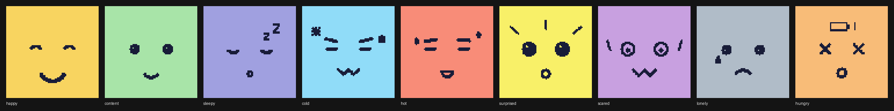

# firmware_pico4ml/ — PersonaSticker 簡素版(Arducam Pico4ML-BLE)

本番の ESP32 版(`../firmware/`)の部品がそろう前に、手元の **Arducam Pico4ML-BLE**(RP2040)1 台で
「センサー → 感情 → 表情」を実機で動かすための版です。**感情エンジン(`../firmware/lib/emotion_core`)は ESP32 版・
シミュレーター・テストと同じものをそのまま使い**、センサー・表示・ループだけを書き直しています。

## ESP32 版との違い

| | ESP32 版(本番) | この簡素版 |
|---|---|---|
| マイコン | XIAO ESP32S3 | RP2040(Pico4ML-BLE) |
| 温度 | AHT20 | IMU(ICM-42622 / ICM-20948)のチップ温度 + ずれの補正 |
| 振動 | LIS3DH | IMU の加速度(±4 g、10 ms ごと) |
| 明るさ | BH1750(lux) | カメラ HM01B0。自動露出に任せ、選ばれた露出・ゲインで画素の平均を割り戻した値(`light`、下の「明るさの尺度」)。撮る時だけ起こし、ふだんは待機 |
| 表示 | 1.54" 電子ペーパー 200×200 | 0.96" カラー液晶 80×160。表情は 80×80 に縮め、感情ごとに背景の色を変える |
| 電源 | LiPo + ディープスリープ | USB 給電で常時動作、1 秒ごとに更新 |
| 通信 | Wi-Fi メッシュ + ブラウザ | USB シリアルに 1 秒 1 行の JSON。BLE モジュールが接続中なら同じ行を BLE にも流す [VERIFY] |
| 放置で「さみしい」 | 48 時間 | デモモード(既定 ON)では 60 秒 |

表情 9 種を液晶の 80×80 に縮めた見え方(PC で `tools/preview_faces.cpp` から作った絵):



happy / content / sleepy / cold / hot / surprised / scared / lonely / hungry。どれも見分けられることを確かめた。

## ビルド・書き込み

```bash
cd software/firmware_pico4ml
pio run                 # ビルド
pio run -t upload       # BOOTSEL ボタンを押しながら USB をつなぐ(RPI-RP2 ドライブ)→ 書き込み
pio device monitor      # USB シリアル 115200
```

## つないだら確かめること(上から順に)

1. **起動画面**: 液晶の下に `CAM OK` と `IMU ICM426XX`(または ICM20948)が緑で出る。赤なら、シリアルの最初の行(`# PersonaSticker pico4ml cam=… imu=…`)を控え、`i`(I2C の一覧)と `c`(カメラの信号)を送る。
2. **温度のずれ**: 部屋の温度計と、JSON の `temp` を比べる。ずれた分を `o<補正値>` で入れる(例: 実際 22 ℃ で `temp` が 25 ℃ なら、今の補正 −5 から 3 引いて `o-8`)。チップ温度は基板の熱で室温より高く出る。
3. **暗さ**: 置いた時と、カメラを指でふさいだ時の `light` を見て、その間を `l<値>` で入れる(既定 1.5、下の実測から)。
4. **表情**:
   - 何もしない → content か happy(快適な温度なら happy 寄り)
   - 軽くなでる・ゆらす(0.15 g〜)→ happy に寄る
   - 強くたたく・振る(1.2 g〜)→ **surprised**、続けて振ると **scared**(3 秒は表示を保つ)
   - カメラをふさぐ → **sleepy**
   - 60 秒さわらない(デモモード)→ **lonely**
   - 温める(手で包む・ドライヤー)→ 30 ℃ を超えると **hot**
   - 冷やす(保冷剤)→ 10 ℃ 未満で **cold**

## シリアルのコマンド(1 行で送る)

| コマンド | 意味 |
|---|---|
| `h` | 今の設定の表示 |
| `n<NAME>` | 名前(英数字) |
| `p0` / `p1` / `p2` | 性格: ほがらか / こわがり / おっとり |
| `s<0-100>` | 感度 |
| `o<℃>` | 温度のずれの補正(既定 −5.0)[VERIFY] |
| `l<値>` | 暗いとみなす `light`(既定 1.5) |
| `e<行>` / `a<0-3>` | 手動の露出の行数(最大 368)/ アナログゲイン 1x〜8x。どちらも自動露出を切る |
| `x` | 自動露出に戻す(既定) |
| `d` | デモモードの入/切 |
| `i` / `c` / `g` | 診断: I2C の一覧と IMU の生の値 / カメラの信号 / 画像を 162x162 の PGM で流す |

設定は電源を切ると戻る(保存はしていない)。

## 出力(1 秒 1 行)

```json
{"t":12,"face":"happy","v":0.52,"a":0.10,"temp":23.40,"temp_chip":28.40,"temp_rate":0.00,"light":96,"dark":0,"vib":0.012,"idle_s":3,"ble":0}
```

## 明るさの尺度

`light = 画素の平均 × (368 / 露出の行数) / (アナログゲイン × デジタルゲイン)`。
「露出 368 行・ゲイン 1x で撮った時の平均」に当たる。固定の露出だと置き方しだいで 13(真っ暗)にも 255(真っ白)にもなったので、自動露出にした。

## 実機で確かめたこと(2026-11-14、電気をつけた部屋)

| やったこと | 値 | 顔 |
|---|---|---|
| 机に置いたまま | light 134、揺れ 0.01〜0.03 g | content |
| 指でカメラをふさぐ | light 0.5〜0.7 | **sleepy** |
| 軽くゆらす | 揺れ 0.2〜0.7 g | **happy**(一瞬) |
| たたく・振る | 揺れ 1.1〜5.9 g(5.9 = ±4 g で頭打ち) | **surprised** → **scared** |
| 60 秒さわらない(デモ) | — | **lonely** |
| 温める | temp 30 ℃ 超(チップ 35 ℃ 超) | **hot**(利用者が確認) |
| 冷やす | temp 10 ℃ 未満(チップ 15 ℃ 未満) | **cold**(利用者が確認) |

9 種のうち実機で出ていないのは hungry だけ(USB 給電で電池を 4200 mV 固定にしているため出ない)。

置き方で暗い側を向くと light は 3.5〜12 に下がる(静かに置いても、自動露出の読み返しのずれで 2〜3 倍揺れる)。ふさいだ時との間を取って、暗さの閾値を 1.5 にした。

実機で分かった基板の癖:
- IMU は ICM-42622 ではなく **ICM-42602**(WHO_AM_I = 0x41)。レジスタの並びは同じ。
- 起動によっては**カメラの設定表の一部が効かない**(約 60 fps の初期値のまま撮影が始まる)。リセットから入れ直し、読み返して確かめている。
- カメラの撮影中は **I2C が化ける**(IMU の読みの後ろが 0x00 / 0xFF になる)。カメラは撮る時だけ起こし、IMU は 2 回読んで一致した時だけ使う。
- picotool は USB ドライバ(Zadig)が無いとつながらない。1200 bps で開くと BOOTSEL に入るので、出てきた RPI-RP2 ドライブに `.pio/build/pico4ml/firmware.uf2` をコピーすれば書ける。

## 未確認のこと([VERIFY])

- 温度のずれ(−5 ℃)。室温計と比べていない(hot / cold は確認済み)。
- 自動露出の読み返しは最後のフレームの後なので、明るさが 2〜3 倍揺れる。
- BLE モジュールの仕様(接続を `IND=BLECONNECTED` で知らせる、透過で流れる)は ArduCAM の magic_wand_ble の例から推した。未確認。
- カメラで撮っている約 0.3〜0.4 秒(3 秒に 1 回)は加速度を読めないので、その間の短いたたきは取りこぼす。

## 構成

```
firmware_pico4ml/
├── platformio.ini       # arduino-pico(earlephilhower)、emotion_core は ../firmware/lib から
├── src/
│   ├── board.h / .cpp   # 液晶 ST7735・カメラ HM01B0(PIO + DMA)・IMU・BLE の UART
│   ├── face_lcd.h       # 200x200 の表情 → 80x80 のカラー(PC のツールと共通)
│   └── main.cpp         # 1 秒ごとの更新・表示・シリアルのコマンド
└── tools/preview_faces.cpp  # 液晶に出る表情を PC で PPM に書き出す
```

ピン・初期化列は ArduCAM/pico-tflmicro(`include/arducam_hm01b0`、`include/LCD_st7735`、`include/ICM42622`、
`examples/magic_wand_ble`)から。カメラと液晶のコードは、同じ基板で動作を確かめた別の実験ファームから写した。
